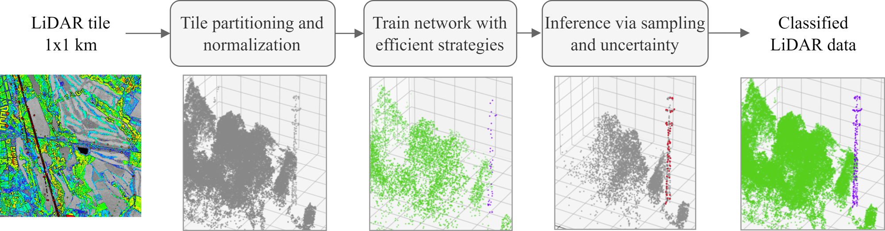
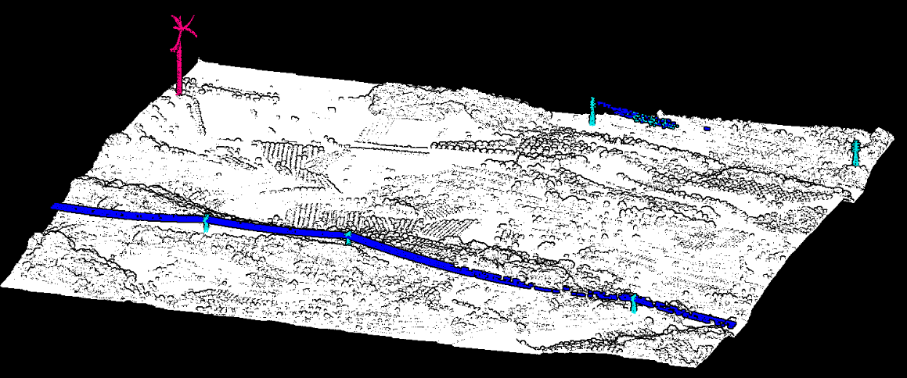
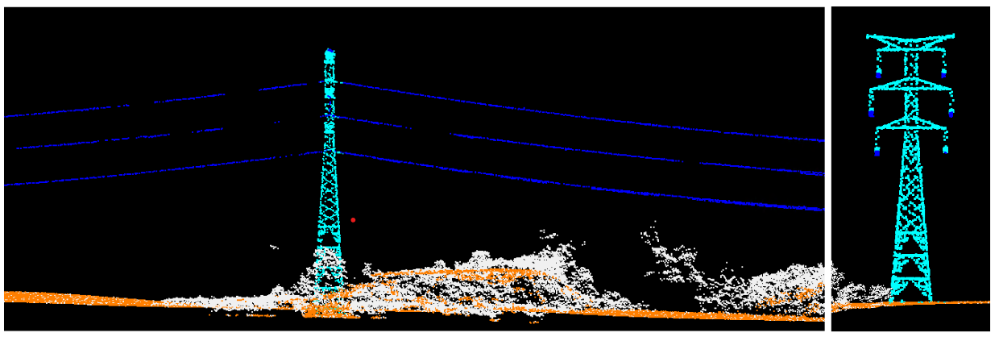

# Effective Training and Inference Strategies for Point Classification in LiDAR Scenes

[](https://www.mdpi.com/2072-4292/16/12/2153)
[](https://doi.org/10.3390/rs16122153)
[](https://opensource.org/licenses/MIT)

Official PyTorch implementation and trained weights for the paper *"Effective Training and Inference Strategies for Point Classification in LiDAR Scenes"* (Remote Sensing, 2024). The work covers semantic segmentation of Airborne Laser Scanning (ALS) point clouds over hilly, forested and urban terrain.

---

## 👨‍🔬 Authors & Affiliations
* **[Mariona Carós](https://www.linkedin.com/in/marionacaros/)** (University of Barcelona & Cartographic and Geological Institute of Catalonia)
* **[Ariadna Just](https://www.linkedin.com/in/ariadna-just-0a667559/)** (Cartographic and Geological Institute of Catalonia)
* **[Santi Seguí](https://ssegui.github.io/)** (University of Barcelona)
* **[Jordi Vitrià](https://algorismes.github.io/)** (University of Barcelona)

---

## 📖 Abstract
Light Detection and Ranging (LiDAR) systems are essential for 3D environment understanding, but automating point classification is hard: point density varies across scenes, object shapes are ambiguous, and classes are extremely imbalanced. We study the elements of a deep-learning segmentation pipeline that lie **beyond the network architecture**, using a self-captured dataset from a hybrid ALS sensor with RGB and NIR cameras over **247 km²** of hilly, urban and densely forested terrain. With the right training and inference strategies, a plain PointNet++ reaches **94.24% mIoU** and outperforms later architectures such as KPConv.

<details>
<summary><b>Click to read the full abstract</b></summary>

Light Detection and Ranging systems serve as robust tools for creating three-dimensional representations of the Earth's surface. These representations are known as point clouds. Point cloud scene segmentation is essential in a range of applications aimed at understanding the environment, such as infrastructure planning and monitoring. However, automating this process can result in notable challenges due to variable point density across scenes, ambiguous object shapes, and substantial class imbalances. Consequently, manual intervention remains prevalent in point classification, allowing researchers to address these complexities. In this work, we study the elements contributing to the automatic semantic segmentation process with deep learning, conducting empirical evaluations on a self-captured dataset by a hybrid airborne laser scanning sensor combined with two nadir cameras in RGB and near-infrared over a 247 km² terrain characterized by hilly topography, urban areas, and dense forest cover. Our findings emphasize the importance of employing appropriate training and inference strategies to achieve accurate classification of data points across all categories. The proposed methodology not only facilitates the segmentation of varying size point clouds but also yields a significant performance improvement compared to preceding methodologies, achieving a mIoU of 94.24% on our self-captured dataset.
</details>

---

## 🔑 Key Research Contributions
* **A pipeline for scenes of varying size:** it segments outdoor point clouds ranging from $10^3$ to $4\times10^5$ points.
* **Architecture-independent gains:** training and inference strategies alone raise IoU by **+21.7%**, reaching **94.24% mIoU** (vs. 72.56% for KPConv). Results are on our self-captured ALS data, which includes the open [TerLiDAR](https://marionacaros.github.io/terlidar/) dataset.
* **Uncertainty-based inference:** a new strategy that re-samples only the points whose predictions disagree. It improves minority-class IoU by up to **+2.9%** and is **~10× faster** than 13-vote voting at almost the same accuracy.

---

## 🧭 Method



The pipeline has three stages:

### 1. Tile partitioning and height normalization
* **Height normalization:** the ground elevation (ICGC topographic ground model) is subtracted from every point, so `z` becomes *height above ground*.
* **Tile partitioning:** 1×1 km tiles are split into **100×100 m subtiles** (50 m overlap for training, 20 m for testing). This size fits target objects of 30–120 m at densities of 13–27 pts/m².
* **Ground filtering:** ground points are removed only when a subtile has more points than the network input size. This keeps isolated objects on flat ground together with their context.
* **Input features:** `x, y, z`, intensity, `R, G, B`, `NIR` and **NDVI** $=\frac{NIR-R}{NIR+R}$. Coordinates are normalized to $[-1, 1]$ and features to $[0, 1]$.

### 2. Training strategies (PointNet++ backbone)
An additive ablation, starting from PointNet++ with step decay, Adam and no augmentation:

| Training strategy | Tower | Power Lines | Wind Turbine | Surround. | Global mIoU | Δ |
| :--- | ---: | ---: | ---: | ---: | ---: | ---: |
| Baseline | 56.77 | 77.23 | 0.00 | 99.98 | 58.50 | – |
| + Cosine LR decay | 57.82 | 83.15 | 0.00 | 99.99 | 60.24 | +1.7 |
| + Rotation | 58.62 | 82.74 | 0.00 | 99.99 | 60.34 | +0.1 |
| + **Resampling** (new random 4096 pts each iteration) | 77.85 | 94.09 | 96.54 | 99.99 | 92.12 | **+31.8** |
| + Label smoothing | 77.65 | 93.37 | 99.09 | 99.99 | 92.52 | +0.4 |
| + AdamW | 77.74 | 93.66 | 91.60 | 99.99 | 90.75 | −2.1 |
| + Color dropout | 78.57 | 93.76 | 95.76 | 99.99 | 92.02 | +1.27 |
| + Weighted CE loss | 79.31 | 94.85 | 97.97 | 99.99 | 93.03 | +1.01 |

**Findings:**
* **Resampling** is by far the most effective strategy. Wind turbines go from undetected to 96.5% IoU.
* Cosine decay, rotation, color dropout and a class-weighted loss all help. The weighted loss improves every minority class.
* Label smoothing and AdamW give mixed results on this data, so the final model does not use them.

### 3. Inference strategies
* **Batch of random samplings:** each subtile is split into a batch of random 8K-point samples instead of being fed whole. This is much more accurate (see the table below) and faster.
* **Voting:** majority vote over several random samplings. Accuracy improves, but inference time grows linearly with the number of votes.
* **Uncertainty-based sampling (proposed):** each point gets two predictions from two different random samplings. Points where they disagree are *uncertain* (non-zero entropy). The point cloud is then re-sampled around them with a smooth-KNN distribution on xy distances, $P_{ij} = \exp(-\beta\,\lVert q_i - p_j\rVert^2)$. Neighbours of uncertain points are favoured while the sample keeps its natural (non-spherical) shape.

| Inference strategy | Alt Empordà | Ribera de Ter | Terra Alta |
| :--- | ---: | ---: | ---: |
| All points | 51.6 | 37.9 | 46.0 |
| **Samples of 8K pts** | **87.9** | **85.8** | **94.7** |
| Samples of 16K pts | 87.1 | 85.7 | 93.6 |

| Strategy (8K samples) | Alt Empordà | Ribera de Ter | Terra Alta | Global mIoU | Time (min) |
| :--- | ---: | ---: | ---: | ---: | ---: |
| 1 vote | 87.9 | 85.8 | 94.7 | 93.2 | 36 |
| 13 votes | 90.2 | 88.0 | 95.6 | 94.3 | 455 |
| **Uncertainty-based** | 89.9 | 88.1 | 95.4 | 94.2 | **42** |

---

## 🗺️ Dataset
The experiments use our self-captured airborne data. Region (II) Ribera de Ter is publicly released as the [TerLiDAR](https://marionacaros.github.io/terlidar/) dataset. The data were captured over three regions of Catalonia (Spain) by the ICGC with a **Leica TerrainMapper 2**: a circular-scan LiDAR plus two nadir RGB and NIR cameras (~11 cm GSD).

| | (I) Alt Empordà | (II) Ribera de Ter ([TerLiDAR](https://marionacaros.github.io/terlidar/)) | (III) Terra Alta |
| :--- | :---: | :---: | :---: |
| Landscape | hilly, dense forest | riparian vegetation | flat fields with wind farms, mountains with power facilities |
| Area | 67 km² | 60 km² | 120 km² |
| Mean point density | 13 pts/m² | 16 pts/m² | 27 pts/m² |
| Flight date | April 2021 | July 2021 | May 2021 |
| Train / test tiles (1×1 km) | 59 / 8 | 72 / 12 | 110 / 10 |

Objects were labeled manually in TerraScan. The classes are extremely imbalanced:

| | Tower | Power Lines | Wind Turbine | Ground | Surrounding |
| :--- | ---: | ---: | ---: | ---: | ---: |
| Points | 369 K | 583 K | 46 K | 1.34 B | 1.68 B |
| % | 0.012 | 0.018 | 0.001 | 44.5 | 55.4 |

*Surrounding* covers vegetation, buildings and other infrastructure. Ground is filtered out before the network and is not included in the reported mIoU.

> [!NOTE]
> The data is not distributed in this repository.
> * Region (II) Ribera de Ter is openly available as **[TerLiDAR](https://marionacaros.github.io/terlidar/)**: 51.4 km² of urban and forested areas, 692 M annotated colorized points, CC BY 4.0. Download links are sent after filling in the form on its page.
> * The other regions can be requested from the [ICGC](https://www.icgc.cat/) for research purposes.

---

## 📊 Results

### Comparison with KPConv
| Network | Inference | Tower | Power Lines | Wind Turbine | Surround. | Global mIoU |
| :--- | :--- | ---: | ---: | ---: | ---: | ---: |
| KPConv | spheres | 41.33 | 74.76 | 74.76 | 99.41 | 72.56 |
| PointNet++ | all points | 11.86 | 1.14 | 70.09 | 97.07 | 45.04 |
| PointNet++ | 8K samples | 79.74 | 95.31 | 97.92 | 99.99 | 93.24 |
| **PointNet++** | **uncertainty-based** | **82.66** | **95.97** | **98.33** | **99.99** | **94.24** |

### Per-dataset results (uncertainty-based inference)
| Dataset | Tower | Power Lines | Wind Turbine | Surrounding | mIoU | Time (min/km²) |
| :--- | ---: | ---: | ---: | ---: | ---: | ---: |
| (I) Alt Empordà | 79.89 | – | – | 99.99 | 89.94 | 1.39 |
| (II) Ribera de Ter | 74.41 | 89.98 | – | 99.99 | 88.13 | 1.47 |
| (III) Terra Alta | 85.71 | 97.72 | 98.33 | 99.99 | 95.43 | 1.63 |

### Robustness on Out-of-Domain (OOD) data
On 4 km² from an unseen location (15 pts/m², July 2021), the model keeps **94.33% mIoU**:

| Tower | Power Lines | Surrounding | mIoU | Time (min/km²) |
| ---: | ---: | ---: | ---: | ---: |
| 89.48 | 97.55 | 95.96 | 94.33 | 2.13 |

### Known limitations
* **Tower vs. power line confusion** where cables meet the tower, because the two are structurally similar and very close.
* **False-positive towers** on tall vertical structures such as poles.
* **NDVI artefacts:** thin structures are not always visible in the aerial images. Tower cross-arms can then get vegetation colours (high NDVI) during RGB/NIR assignment and be misclassified.

---

## 🖼️ Visual Results

### Terrain Segmentation Performance
Ground truth vs. model predictions on hilly topography (Terra Alta).


### Out-of-Distribution (OOD) Robustness
Predictions on scenes from an unseen geographical location.


---

## 📦 Model Weights
The best-performing weights (PointNet++, trained with the strategies above) are provided in the repository:
* **Path:** `src/checkpoints/seg_01-23-10:55_weighted.pth`

> [!TIP]
> Use these weights for out-of-the-box inference on the four classes of this paper (tower, power lines, wind turbine, surrounding), or as a backbone for further fine-tuning.

**Implementation details (paper):** PyTorch, batch size 64, initial learning rate 0.01 with cosine decay, up to 100 epochs with early stopping on validation loss, 4096 training points per sample and 8000 points per inference sample. The model was trained on an NVIDIA RTX A6000 (48 GB).

---

## 🙏 Acknowledgements
This research was funded by an Industrial Doctorate grant (2021DI41, AGAUR, Generalitat de Catalunya) between the Universitat de Barcelona and the Institut Cartogràfic i Geològic de Catalunya (ICGC), and by grants PID2022-136436NB-I00 and 2021SGR01104. The LiDARCAT3 data acquisition was funded by the European Next-Generation funds (Recovery, Transformation and Resilience Plan, MITECO), coordinated by the IGN.

---

## 📝 Citation
If you find this work useful for your research, please cite:
```bibtex
@Article{rs16122153,
  AUTHOR = {Carós, Mariona and Just, Ariadna and Seguí, Santi and Vitrià, Jordi},
  TITLE = {Effective Training and Inference Strategies for Point Classification in LiDAR Scenes},
  JOURNAL = {Remote Sensing},
  VOLUME = {16},
  YEAR = {2024},
  NUMBER = {12},
  ARTICLE-NUMBER = {2153},
  URL = {https://www.mdpi.com/2072-4292/16/12/2153},
  ISSN = {2072-4292},
  DOI = {10.3390/rs16122153}
}
```
